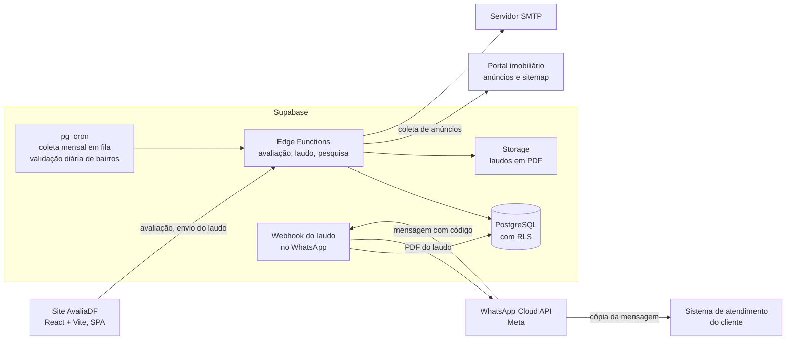

# AvaliaDF · Manutenção e evolução de um avaliador imobiliário em produção

O AvaliaDF é uma plataforma de inteligência imobiliária do Distrito Federal: o visitante preenche os dados de um imóvel, recebe uma avaliação gratuita calculada sobre anúncios reais do mercado e baixa o laudo em PDF, que também chega por e-mail e pelo WhatsApp. O site também publica índices mensais de valor do metro quadrado, liquidez e rentabilidade por região. O AvaliaDF pertence à Êxito Netimóveis, que me contratou como desenvolvedor full stack freelancer para a manutenção e evolução do produto já em produção: diagnóstico, correção e novas funcionalidades na busca, no laudo, na entrega por WhatsApp e e-mail, na segurança e no desempenho.

**Site:** [avaliadf.com.br](https://avaliadf.com.br)

> Este repositório é um estudo de caso, não um repositório de código. O código-fonte pertence ao cliente e continua privado. Tudo o que está aqui descreve o meu próprio trabalho, em um nível de detalhe que posso aprofundar em entrevista.

---

## Visão geral

| | |
|---|---|
| **Meu papel** | Desenvolvedor full stack freelancer, único desenvolvedor no código do produto: frontend, funções de servidor, banco de dados, integrações e relatórios técnicos para o cliente |
| **Período** | Maio a setembro de 2026 |
| **Status** | Entrega concluída em setembro de 2026, com todas as correções e funcionalidades publicadas e validadas em produção |
| **Stack** | React, TypeScript, Vite, Tailwind CSS, shadcn/ui, TanStack Query, Supabase (PostgreSQL, RLS, Edge Functions em Deno, Storage, pg_cron, Vault), jsPDF, Vitest, WhatsApp Cloud API (Meta), SMTP |
| **Código** | 5 Edge Functions (4 novas) · 7 migrations SQL · 7 relatórios técnicos entregues ao cliente |

## O problema

O AvaliaDF já estava no ar quando comecei. A Êxito gerou o produto no Lovable, que permite à equipe dela criar e ajustar telas e conteúdo com rapidez, e continua editando o site por lá. Entrei para dar ao produto o que pede engenharia dedicada: estrutura, integrações com serviços externos, segurança e testes automatizados.

Os pedidos chegavam como sintomas de negócio:

- **"A avaliação sai vazia."** Visitantes informavam os dados exatos de um imóvel anunciado e recebiam uma avaliação sem amostras.
- **"O cliente não recebe nada no WhatsApp."** O formulário registrava o pedido, mas a confirmação e o laudo não chegavam.
- **"Os laudos pararam de chegar."** Em outro momento, a entrega pelo WhatsApp parou e o armazenamento de laudos chegou ao limite do plano, sem nenhum erro aparente no código.
- **Segurança antes da divulgação.** O painel da plataforma acusava alertas de segurança, e o cliente queria saber o que era real antes de investir em tráfego.

A avaliação é o produto principal do site: é ela que gera o laudo que o visitante veio buscar e o contato que vira lead para o cliente. Cada problema aqui era perda direta de credibilidade ou de cliente.

## Restrições

- **Produto vivo, com duas frentes de trabalho em paralelo.** A equipe do cliente continuou evoluindo o site pelo Lovable durante todo o meu trabalho (cerca de 600 commits da plataforma no mesmo período). Cada publicação substitui o sistema inteiro, então minhas entregas precisavam conviver com publicações feitas pela equipe do cliente.
- **Validação só contra produção.** A avaliação depende de um portal imobiliário externo real. As medições e testes de busca foram feitos contra o portal e o ambiente de produção, espaçados e repetidos em dias distintos.
- **Fonte externa que muda sem aviso.** Durante a própria correção, o portal mudou o formato de paginação e a forma de publicar os filtros de bairro.
- **Dois sistemas, recursos compartilhados.** O AvaliaDF e o sistema de atendimento do cliente dividem a mesma organização de banco de dados, a mesma cota de armazenamento e o mesmo número de WhatsApp. Um problema em um podia derrubar o outro.
- **Limites de plataforma.** Funções de servidor encerradas em cerca de 150 segundos, cota de armazenamento do plano e regras da Meta para aplicativos e janelas de conversa no WhatsApp.

## Arquitetura

- O site é uma SPA em React. As gravações feitas por visitantes não autenticados passam por funções de servidor, que validam a entrada antes de escrever no banco ou no armazenamento.
- A avaliação coleta os anúncios do portal em tempo real, percorre todas as páginas dentro de um teto de tempo e desce pela cascata quando o bairro não responde.
- O laudo é gerado em PDF, guardado no armazenamento e entregue por download, e-mail e WhatsApp.
- No WhatsApp, a Meta entrega uma cópia de cada mensagem do número para cada aplicativo inscrito. O webhook do AvaliaDF só trata mensagens com código de laudo, e o sistema de atendimento ignora essas mesmas mensagens, então cada sistema continua dono do seu fluxo.
- Rotinas agendadas no banco avançam a coleta mensal em lotes e revalidam o cadastro de bairros todos os dias.

## Principais decisões e trade-offs

| Decisão | Alternativas consideradas | Por quê | Custo aceito |
|---|---|---|---|
| Laudo pelo WhatsApp iniciado pelo cliente, com código gerado no site ([ADR 0001](docs/adr/0001-laudo-pelo-whatsapp-iniciado-pelo-cliente.md)) | Enviar o laudo ativamente para o telefone do formulário; integrar com o CRM que opera o número comercial | A conversa aberta pelo cliente fica dentro da janela em que a Meta permite responder livremente, o contato vira lead qualificado e não há dependência de terceiros | O cliente precisa enviar a mensagem. O reconhecimento do código precisa ser idêntico nos dois sistemas que recebem as mensagens |
| Busca em cascata com aviso de abrangência ([ADR 0002](docs/adr/0002-busca-em-cascata-com-aviso-de-abrangencia.md)) | Devolver avaliação vazia; ampliar para a cidade sem avisar | Nenhum visitante sai sem resposta quando há oferta na região, e o laudo diz de onde veio a amostra | Consultas que descem a cascata fazem mais requisições, e cada anúncio é conferido contra o bairro |
| Ler todas as páginas de resultado, com teto de 30 segundos | Ler só a primeira página | Amostra de 30 a 40 anúncios passou para 900 a 1.500, e a estimativa ficou estável entre execuções | A consulta completa leva até 30 segundos, com teto configurável se o cliente preferir velocidade |
| Sitemap de busca do portal como fonte única de bairros, com validação diária ([ADR 0003](docs/adr/0003-sitemap-do-portal-como-fonte-unica-de-bairros.md)) | Extrair bairros dos endereços dos anúncios e completar com fontes automáticas; ler os filtros da página | Fonte canônica, atualizada diariamente, que o portal reconhece por construção | Depende de o portal manter o sitemap. Cidade fora dele fica como está |
| Coleta mensal em fila retomável com orçamento de tempo ([ADR 0004](docs/adr/0004-coleta-mensal-em-fila-retomavel.md)) | Uma invocação por cidade; funções que se chamam em cadeia por HTTP | Uma cidade pode exigir centenas de consultas, mais do que cabe em uma invocação. A fila sobrevive a uma invocação interrompida | Uma tabela de estado e um agendamento a mais para manter |
| Compressão sem perda das imagens do laudo | Contratar plano maior para liberar a cota de armazenamento | Resolve a causa em vez do sintoma e evita um custo mensal recorrente | O modo de compressão mais lento, executado uma vez por laudo |
| Gravações de visitantes via funções de servidor | Gravação direta do navegador no banco | Validação de entrada no servidor e banco sem acesso direto de visitantes | Uma chamada a mais por gravação |

## O que entreguei, por tema

### Busca e avaliação
- **Diagnóstico medido.** Antes de propor qualquer correção, medi o problema em produção em duas amostras independentes: entre 36% e 47% dos bairros oferecidos no formulário não retornavam nenhum anúncio, e toda avaliação usava só a primeira página do portal (cerca de 0,7% da oferta em uma região grande).
- **Coleta completa.** Reconstruí a paginação para descobrir o formato do portal em tempo de execução. As avaliações passaram de 1 página para 30 a 41 páginas lidas.
- **Busca em cascata.** Quando o bairro não responde, a busca desce para palavra-chave conferida e depois para a cidade, e trata regiões que o portal publica como bairro de outra cidade. As 16 regiões que antes nunca retornavam resultado passaram a responder, entre elas algumas das de maior valor do DF.
- **Cadastro de bairros limpo.** Restringi o cadastro à fonte oficial e troquei apagar e reinserir por atualização que preserva a validação. Quando o portal mudou a forma de publicar os filtros no meio da entrega, ajustei a fonte para o sitemap de busca no mesmo ciclo. Base repovoada com 214 bairros em 26 cidades.
- **Validação contínua.** Rotina diária confere os bairros contra o portal e esconde do formulário os que não têm oferta, sem nunca deixar uma cidade sem opção.
- **Casos de borda tratados.** O índice mensal nunca grava número de cidade como se fosse de bairro, bairro só com oferta de aluguel continua no menu e falhas transitórias não derrubam a consulta.

### Laudo, WhatsApp e e-mail
- **Diagnóstico do WhatsApp.** Identifiquei que o número comercial estava sob gestão exclusiva de outra plataforma, o que pela regra da Meta impede um segundo sistema de enviar por ele. Entreguei ao cliente um diagnóstico com três caminhos e uma recomendação de curto e longo prazo.
- **Bot de entrega do laudo.** Implementei o fluxo completo: código curto gerado no site, botão "Receber no WhatsApp", tabela de pedidos, webhook que reconhece o código e responde com o PDF. Mensagens sem código são descartadas sem gravação.
- **E-mail.** Passei o envio do laudo para SMTP, implementei o envio automático e o botão de download na página de resultado, e fiz os endereços dos templates de e-mail virem da configuração do ambiente.
- **Entrega restabelecida.** Quando os laudos pelo WhatsApp pararam de chegar, rastreei a causa até a política de privacidade: o validador da Meta não conseguia acessá-la, e o aplicativo saiu do ar. Publiquei a política no domínio do produto, com uma função que entrega o HTML completo já na primeira resposta (o validador não executa JavaScript), e versionei essa função no repositório. Teste de ponta a ponta: laudo entregue em 1 minuto e 14 segundos.

### Segurança
- **Análise dos alertas.** Analisei cada alerta do scanner automático contra o código e o banco reais e entreguei ao cliente um relatório em linguagem acessível, separando falsos positivos de pontos que mereciam ajuste. Os ajustes foram aplicados no mesmo dia.
- **Correções de autorização.** Movi as gravações de visitantes para funções de servidor com validação de entrada e de arquivo, e revisei as políticas de acesso do banco e do armazenamento.
- **Revisão do projeto inteiro.** Depois da correção da busca, fiz uma revisão de segurança, configuração e qualidade de todo o projeto e entreguei o resultado ao cliente.

### Desempenho e custo
- **Laudo 94% menor.** Medi que quatro imagens fixas, que somam 54 KB em disco, ocupavam 4,14 MB dentro de cada laudo por falta de compressão. Ativei compressão sem perda: as imagens ficaram 98,7% menores e saem idênticas byte a byte. Cada laudo passou de cerca de 4,4 MB para cerca de 250 KB.
- **Cota destravada sem upgrade.** O armazenamento de laudos tinha estourado a cota compartilhada e travava anexos também no sistema de atendimento. Com a compressão e a remoção de 84 arquivos redundantes (347 MB, com backup conferido byte a byte antes), o cliente deixou de ser obrigado a contratar um plano pago.
- **Coleta mensal funcionando.** Identifiquei que a coleta agendada nunca tinha rodado e redesenhei a execução em fila com retomada ([ADR 0004](docs/adr/0004-coleta-mensal-em-fila-retomavel.md)).

## Desafios

**Uma avaliação vazia com o imóvel anunciado.** O sintoma parecia um único defeito, mas eram três: nomes de bairro que o portal não reconhece no endereço de busca, paginação que parou de funcionar quando o portal mudou o HTML e regiões que o portal organiza como bairro de outra cidade. Medi cada um em produção, propus a correção com escopo e prazo fechados e, na entrega, repeti as mesmas medições do diagnóstico em um relatório de antes e depois. A mesma consulta executada três vezes em horários diferentes passou a variar menos de 0,1% no preço médio, porque o valor deixou de depender de qual recorte o portal exibia primeiro.

**Laudos que pararam sem nenhum erro no código.** A integração com a Meta estava correta, mas o aplicativo tinha saído do ar porque a URL da política de privacidade respondia erro ao validador. Como o site é uma SPA, mesmo uma página nova serviria para o validador só uma casca vazia. Resolvi com uma função que entrega o HTML completo, lendo o mesmo arquivo de texto que a página React usa, para que o texto jurídico exista em um só lugar.

**Entregas que convivem com as publicações do cliente.** Cada publicação pelo Lovable substitui todas as funções e pode reescrever arquivos de configuração. Para que as duas frentes de trabalho seguissem juntas sem uma desfazer a outra, levei para o repositório tudo o que estava implantado fora dele, fixei a configuração crítica em arquivos que a plataforma não sobrescreve e cobri os pontos sensíveis com testes que falham se o comportamento voltar.

**Uma coleta que não cabia em uma execução.** A coleta mensal precisava de centenas de consultas por cidade, com espera entre elas, e a função é encerrada em cerca de 150 segundos. Encadear chamadas HTTP não funcionava, porque a requisição morre junto com a instância. A solução foi uma fila no banco, avançada em lotes por um agendamento, em que cada execução retoma do último ponto gravado.

## Resultados

- Buscas do formulário que terminavam em avaliação vazia: de 36% a 47% para nenhuma, quando há oferta na região.
- Anúncios analisados por avaliação: de 30 a 40 para 900 a 1.500, com 16 regiões recuperadas.
- Laudo em PDF de cerca de 4,4 MB para cerca de 250 KB, sem perda de qualidade, e cota de armazenamento destravada sem contratar plano pago.
- Laudo entregue pelo WhatsApp em pouco mais de um minuto no teste de ponta a ponta em produção.
- Coleta mensal dos índices redesenhada para caber no limite de tempo das funções e retomar de onde parou.
- Alertas de segurança analisados e ajustes de autorização aplicados.
- Cada entrega acompanhada de relatório técnico para o cliente, com medições reproduzíveis.

## Como trabalho

Neste projeto entrei em um produto que já estava em produção e que a equipe do cliente continua evoluindo. Meu processo foi montado para entregar com segurança nesse cenário:

- **Medir antes de corrigir.** Todo pedido começou com um diagnóstico medido em produção, com amostras repetidas em dias distintos, antes de qualquer proposta.
- **Escopo fechado e evidência de entrega.** Cada correção teve proposta com escopo, prazo e critérios verificáveis, e terminou com um relatório que repete as medições do diagnóstico.
- **Especificação primeiro.** Funcionalidades novas, como o bot do WhatsApp, começaram com documento de design e plano de implementação, incluindo casos de borda, privacidade e testes.
- **Testes como rede de segurança.** Os pontos sensíveis que entreguei (código do laudo, compressão do PDF, política de privacidade) têm testes automatizados que falham se o comportamento regredir.
- **Operação cuidadosa.** Backups conferidos byte a byte antes de remover arquivos, conferência do bundle gerado antes de publicar e mudanças aplicadas passo a passo.
- **Assistido por IA, sob minha responsabilidade.** Uso agentes de código para acelerar a investigação e a implementação de tarefas que já defini. Reviso cada diff, rejeito o que não segue o design e mantenho diagnóstico, arquitetura, segurança e decisões com o cliente sob meu controle direto.

## Equipe e créditos

- **Cliente:** a Êxito Netimóveis criou o produto e continua evoluindo as telas e o conteúdo pelo Lovable. Prioridades, regras de negócio e decisões comerciais (como o número de WhatsApp usado) foram definidas junto com ela.
- **Meu trabalho:** todo o código fora das edições feitas pelo Lovable, os diagnósticos, as propostas e os relatórios técnicos.
- **Outro produto do mesmo cliente:** também atendo o sistema de atendimento da Êxito, descrito no estudo de caso [btc-atendimento-case-study](https://github.com/Fergab1/btc-atendimento-case-study).

## Por que não há código aqui

O código pertence ao cliente. Em uma entrevista técnica, posso percorrer qualquer parte do trabalho, incluindo a busca em cascata, o fluxo do WhatsApp, as rotinas agendadas e as correções de desempenho, dentro dos limites desse acordo.

---

Contato: [LinkedIn](https://www.linkedin.com/in/gabriel-souza-fernandes/) · [GitHub](https://github.com/Fergab1)
